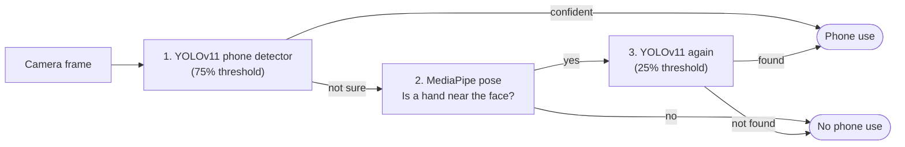

# DriveAware

**Detects drivers using a handheld phone from in-car camera images, video and live webcam.**

DriveAware combines a fine-tuned **YOLOv11** phone detector with **MediaPipe** body-pose estimation. Instead of flagging every phone that appears in the frame, it only gets suspicious when the driver's posture says it should, and it explains every decision in plain English.

Built as my BSc Computer Science dissertation at Brunel University of London (graded A, presented at the Brunel Software Innovation showcase).

---

## Results

| Metric | Score |
|---|---|
| Accuracy | 95.8% |
| Precision | 100% (no false alarms on the test set) |
| Recall | 89.0% (89 of 100 phone users caught) |
| F1 | 94.2% |
| Speed | 6.1 FPS on a laptop CPU |

Measured on **259 held-out test images** (100 with phone use) using YOLOv11 with the default thresholds. YOLOv8 and YOLOv5 were trained on the same data for comparison, and you can re-run all three in the **Evaluation** tab.

> **Honest caveat:** the test images come from the same dataset as the training images, with similar cameras, angles and lighting. These numbers are a starting point, not proof that it works in any car. Testing on real in-car footage is the next step (see [What's next](#whats-next)).

---

## How it works



1. **Detect.** The fine-tuned YOLOv11 model looks for a phone. If it's at least 75% confident, that's enough.
2. **Check posture.** If it isn't sure, MediaPipe estimates the driver's pose and measures how close the nearest hand is to the face.
3. **Look again.** Only when a hand is up by the face does YOLO re-check at a lower 25% threshold, catching phones that are partly hidden by the hand.

An optional filter also requires the detected phone to be in the driver's hand.

Every image result in the app comes with a **"How it decided"** panel that walks through these three steps with the actual confidences and distances.

---

## Features

| Mode | What it does |
|---|---|
| **How it works** | Overview of the pipeline and the evaluation results |
| **Image Analysis** | Upload a photo, take one with your camera, or pick from 259 labelled samples. Each result shows the verdict and the reasoning behind it |
| **Video Analysis** | Frame-by-frame analysis of a clip, with a drive report: safety score, incident timeline and PDF export |
| **Live Webcam** | Real-time detection with an audio alert for sustained phone use |
| **Evaluation** | Runs the full pipeline on the labelled test set and compares YOLOv11, v8 and v5: accuracy, precision, recall, F1, confusion matrix and per-stage timing |

---

## Run it locally

Requires Python 3.10+ (and a webcam for live mode).

```bash
git clone https://github.com/Mxddasir/DriveAware---Yolov11-with-Mediapipe-poseEstimation.git
cd DriveAware---Yolov11-with-Mediapipe-poseEstimation
pip install -r requirements.txt
streamlit run streamlit_fusion_app.py
```

Then open http://localhost:8501.

All model files are included in the repo:

| File | What it is |
|---|---|
| `weights/best.pt` | Fine-tuned YOLOv11 phone detector (used by default) |
| `weights/weightsv8/best.pt` | YOLOv8, trained on the same data (Evaluation tab) |
| `weights/weightsv5/best.pt` | YOLOv5, trained on the same data (Evaluation tab) |
| `pose_landmarker_full.task` | MediaPipe BlazePose model |

---

## Training data

- **Source:** in-car images from the State Farm Distracted Driver Detection dataset (Kaggle).
- **Labelling:** I hand-annotated 2,058 images: 1,799 for training and 259 for testing.
- **Training:** YOLOv11 fine-tuned in Google Colab with transfer learning from COCO-pretrained weights. YOLOv8 and YOLOv5 trained on the same split for a fair comparison.
- **Test labels:** an image with a matching `.txt` label file in `Testing images/` is expected to show phone use; one without is expected to show none.

---

## Project structure

```
├── streamlit_fusion_app.py      # Web app: UI, pipeline orchestration, reports, evaluation
├── models/
│   ├── phone_detector.py        # YOLO wrapper
│   └── pose_estimator.py        # MediaPipe BlazePose wrapper
├── logic/
│   ├── decision_engine.py       # The two-stage decision rule
│   └── proximity_analyzer.py    # Hand-to-face and phone-to-hand distances
├── processors/                  # Stand-alone image and video pipelines
├── utils/
│   ├── visualization.py         # Verdict banner, debug overlay, pose skeleton
│   └── constants.py             # MediaPipe landmark indices
├── config/settings.py           # Default thresholds
├── weights/                     # YOLOv11, v8 and v5 weights
├── Testing images/              # 259 labelled test images
└── Testing videos/              # Sample clips
```

---

## Settings

All thresholds live in the sidebar under **Detection thresholds**. The defaults are the configuration used in the evaluation.

| Setting | Default | Meaning |
|---|---|---|
| Phone confidence (normal) | 0.75 | YOLO confidence needed to flag a phone straight away |
| Phone confidence (when pose is suspicious) | 0.25 | Lower threshold used only for the second look |
| Hand-to-face distance | 0.18 | How close a hand must be to the face to count as suspicious |
| Phone-to-hand distance | 0.12 | How close a phone must be to a hand (only with the hand filter on) |
| Only count phones held in the hand | Off | Ignore phones that aren't near the driver's hand |

Distances are a fraction of the image size. Turn on **Show technical overlay** to see the raw confidences and distances on each frame.

---

## What's next

- **Test on real in-car footage** from a different camera, car and lighting, including at night. This was the main feedback at the showcase.
- **Run on in-car hardware** such as a Raspberry Pi or Jetson, and measure real-world latency.
- **Speed it up.** 6.1 FPS on CPU is fine for a demo but not for a moving car. GPU inference or a smaller model export (ONNX / TensorRT) would help.
- **Broaden the data** with more drivers, phones and seating positions.

---

## Dissertation version

The exact code that was submitted and evaluated is tagged [`original`](../../tree/original). Later changes improve the interface and documentation only. The detection logic and default thresholds are unchanged, so the results above still apply.

---

**Muddasir Khan** · [LinkedIn](https://www.linkedin.com/in/muddasir-khan-/) · [GitHub](https://github.com/Mxddasir)
